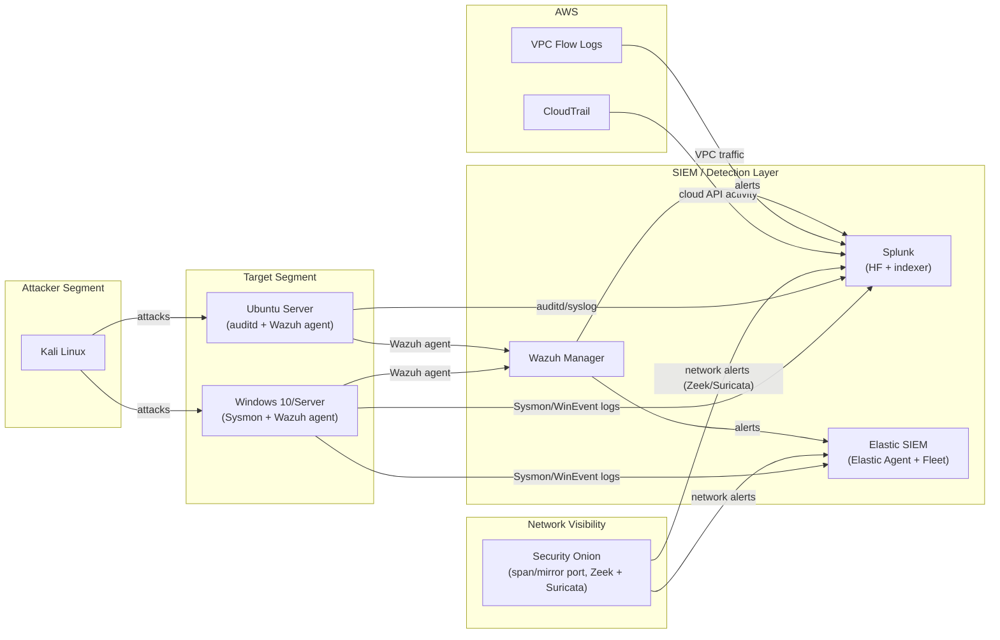

# Lab Architecture

## Overview

The lab is built as an isolated virtual network with an attacker segment, a target segment, and a monitoring/SIEM segment. Nothing in the lab is internet-facing; the only external component is a single AWS account used to generate cloud log sources (CloudTrail, VPC Flow Logs) for cloud-detection practice.

## Components

| Component | Role |
|---|---|
| **Kali Linux** | Attacker box used to run brute-force, lateral movement, and exfiltration simulations |
| **Windows targets** | Domain-joined Windows 10/Server hosts instrumented with Sysmon (process creation, network connection, registry, image load events) |
| **Linux targets** | Ubuntu servers instrumented with `auditd` and the Wazuh agent |
| **Security Onion** | Sits on a mirrored/span port for full network visibility (Zeek connection/DNS/HTTP logs, Suricata IDS alerts) |
| **Wazuh** | Host-based intrusion detection (HIDS), log collection, and custom rule correlation at the endpoint layer |
| **Splunk** | Primary SIEM used for correlation searches, dashboards, and alerting across endpoint, network, and cloud logs |
| **Elastic SIEM** | Secondary SIEM used to validate the same Sigma-derived detections on a second platform and to run Elastic's native detection engine |
| **AWS CloudTrail / VPC Flow Logs** | Cloud log sources streamed into Splunk via the AWS Add-on, used to practice cloud-side detections (e.g. anomalous IAM activity, unusual network flows) |

## Data flow

1. Attacker actions on Kali generate telemetry on the Windows/Linux targets (process creation, auth events, network connections) and on the wire (captured by Security Onion).
2. Sysmon, `auditd`, and the Wazuh agent forward endpoint events to both Splunk (via Universal Forwarder / HTTP Event Collector) and Elastic (via Elastic Agent + Fleet).
3. Security Onion's Zeek/Suricata alerts are forwarded to both SIEMs as well, giving network-layer corroboration for each endpoint-layer detection.
4. AWS CloudTrail and VPC Flow Logs are streamed to Splunk to extend the same detection-engineering workflow to a cloud environment.
5. Sigma rules are authored once and converted with `sigma-cli` into Splunk SPL and Elastic EQL/KQL, so the same detection logic is validated identically on both platforms.
